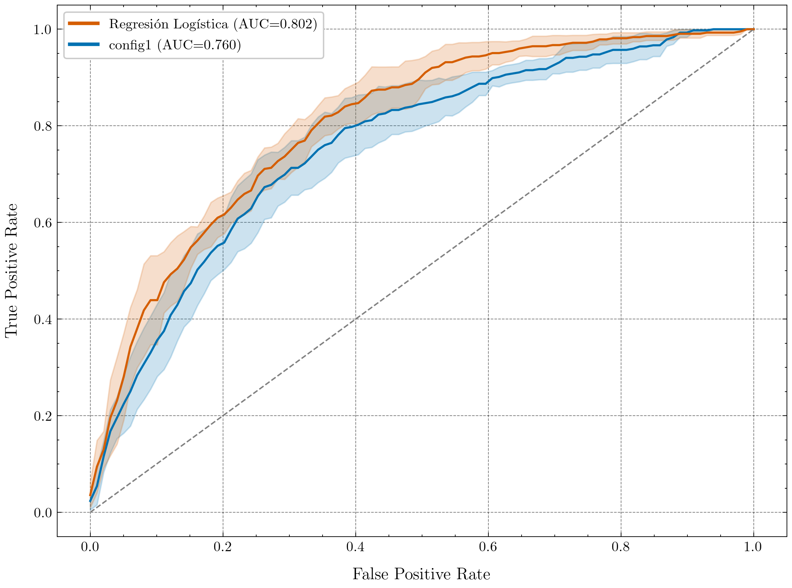

# Prostate Cancer Classification with AI and mpMRI

*[Versión en español](README.es.md)*
 
This Bachelor's thesis compares radiomics and deep learning for prostate cancer
severity classification on multiparametric magnetic resonance imaging (mpMRI),
in terms of both predictive performance and explainability.
 
## Table of Contents
 
- [Introduction](#introduction)
- [Dataset](#dataset)
- [Methodology](#methodology)
- [Results](#results)
- [Repository Structure](#repository-structure)
- [Dependencies](#dependencies)
- [Installation](#installation)
- [Usage](#usage)
- [References](#references)
## Introduction
 
Prostate cancer is one of the most common cancers in men, and its clinical course
varies widely, from indolent tumours to aggressive forms. Multiparametric MRI has
become a more accurate and less invasive alternative to traditional methods such as
PSA testing or biopsy. In this context, artificial intelligence offers promising
support tools to distinguish between severity levels through two main approaches:
radiomics and deep learning. For clinical adoption, both must combine strong
diagnostic performance with explainability.
 
## Dataset
 
This study uses the public dataset from the [PI-CAI](https://pi-cai.grand-challenge.org/) challenge [1],
comprising 1,500 cases with suspected prostate cancer. For each case, axial images
from three MRI sequences are used: T2W, DWI and ADC. Automatic prostate gland
segmentations are also used, together with a binary label indicating the presence
or absence of clinically significant prostate cancer, defined as ISUP grade ≥ 2.
 
## Methodology
 
1. **Radiomic analysis.** Radiomic features are extracted from the MRI scans and
   used to train classical machine learning models.
2. **Deep learning.** Several 3D convolutional neural networks are trained directly
   on the images, with no manual feature extraction.
3. **Performance comparison.** Statistical tests are used to compare the models
   within each approach and, subsequently, to analyse the overall differences
   between radiomics and deep learning.
4. **Model interpretability.** Model decisions are analysed with explainability
   techniques to assess their clinical usefulness.
## Results
 
- **Radiomics:** the best-performing model, logistic regression, achieved a median
  AUC of **0.799** in cross-validation.
- **Deep learning:** the best model, based on DenseNet121, achieved a median AUC of
  **0.753**.
- The difference was not statistically significant (p = 0.125), but the effect size
  (Cohen's d = −1.227) indicated a practical advantage for the radiomics approach.
- **Interpretability:** SHAP and LIME identified the radiomic features that most
  influenced each prediction, while occlusion sensitivity highlighted the image
  regions driving the deep learning model's decisions. Radiomics provides
  interpretable numerical descriptors, whereas deep learning visualisations show
  *where* the model looks but not *which properties* of those regions determine
  the classification.
  
<p align="center">
  
</p>

## Repository Structure
 
```
├── artifacts/
│   ├── deep_learning/ # Logs, models and CSVs with deep learning results
│   └── radiomics/     # Radiomic features
├── data_analysis/     # Exploratory data analysis
├── data_structuring/  # Notebook that centralises all the data
├── results/
│   ├── deep_learning/ # Comparative analysis of the deep learning models
│   └── radiomics/     # Radiomics metrics and results
├── train/
│   ├── deep_learning/ # Deep learning training scripts
│   └── radiomics/     # Radiomic feature extraction and modelling scripts
```
 
## Dependencies
 
The current version of the repository depends on the following Python libraries:
 
- joblib==1.4.2
- lime==0.2.0.1
- matplotlib==3.10.1
- monai==1.4.0
- nibabel==5.3.2
- numpy==2.2.5
- pandas==2.2.3
- SciencePlots==2.1.1
- scikit_learn==1.6.1
- scikit_optimize==0.10.2
- scipy==1.15.2
- seaborn==0.13.2
- shap==0.46.0
- SimpleITK==2.5.0
- statsmodels==0.14.4
- torch==2.5.1
- tqdm==4.67.1
## Installation
 
1. Clone this repository:
```bash
   git clone https://github.com/jose-valero-sanchis/prostate_cancer_TFG.git
   cd prostate_cancer_TFG
```
 
2. Install the dependencies:
```bash
   pip install -r requirements.txt
```
 
## Usage
 
1. **Data preparation.** Create the CSV file that centralises all the information
   needed for training: paths to the images, segmentations and target variable.
   The notebook that builds this CSV is in [Data Structuring](./data_structuring/).
2. **Training and validation.** Run the corresponding scripts to train and validate
   the [radiomics](./train/radiomics/) models, the [deep learning](./train/deep_learning/)
   models, or both.
## References
 
[1] A. Saha, J. S. Bosma, J. J. Twilt, B. van Ginneken, A. Bjartell, A. R. Padhani,
D. Bonekamp, G. Villeirs, G. Salomon, G. Giannarini, J. Kalpathy-Cramer, J. Barentsz,
K. H. Maier-Hein, M. Rusu, O. Rouvière, R. van den Bergh, V. Panebianco, V. Kasivisvanathan,
N. A. Obuchowski, D. Yakar, M. Elschot, J. Veltman, J. J. Fütterer, M. de Rooij,
H. Huisman, and the PI-CAI consortium.
"Artificial Intelligence and Radiologists in Prostate Cancer Detection on MRI (PI-CAI):
An International, Paired, Non-Inferiority, Confirmatory Study".
*The Lancet Oncology* 2024; 25(7): 879–887.
